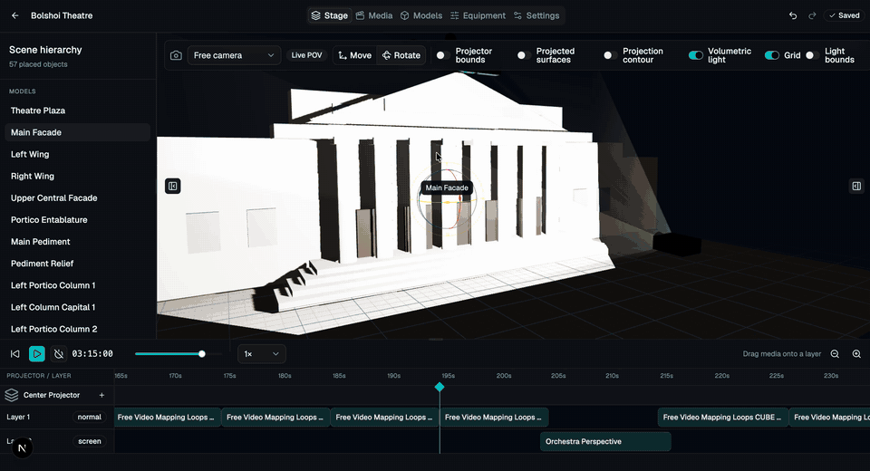

# Mapping

Mapping is an open-source, browser-based projection-mapping studio. It combines
a Next.js editor with a Django API for arranging projectors, lights, cameras,
media, 3D models, and timeline clips in a shared stage workspace.



## Features

- Interactive 3D stage editor built with React Three Fiber
- Projector, light, camera, primitive, and GLB model placement
- Video and procedural generator media sources
- Layered projection timelines with playback and blending controls
- Persistent projects backed by Django and PostgreSQL
- Docker-based development and deployment

## Architecture

| Component | Technology | Purpose |
| --- | --- | --- |
| `frontend/` | Next.js, React, Three.js | Studio user interface |
| `backend/` | Django, Django Ninja | API, persistence, media processing |
| `proxy/` | Nginx | Routes the UI, API, static files, and uploaded media |
| PostgreSQL | PostgreSQL 16 | Application database |

## Requirements

The simplest setup requires Docker with the Compose plugin. Local development
additionally requires Python 3.12+, Node.js 22.22.2+ or 24.15.0+, npm,
PostgreSQL, and FFmpeg.

## Quick start with Docker

1. Create the environment file:

   ```bash
   cp .env.example .env
   ```

2. Replace the example secret and database passwords in `.env`.

3. Create the external proxy network expected by the production compose file:

   ```bash
   docker network create proxy
   ```

4. Build and start the stack:

   ```bash
   docker compose up --build
   ```

The included proxy listens on port `8080` inside its container. Publish or
route that port according to your deployment environment. The API health
endpoint is `/api/health`.

## Local development

Create `.env` as above, install the backend and frontend dependencies, and run:

```bash
python3 -m venv venv
venv/bin/pip install -r backend/requirements.txt
npm --prefix frontend ci
./run_local.sh
```

The default frontend is available at <http://localhost:3000>. `run_local.sh`
starts PostgreSQL in Docker and runs the backend and frontend on the host.
Ports can be changed, for example:

```bash
./run_local.sh --frontend-port 3002 --backend-port 8002 --postgres-port 5434
```

## Development checks

```bash
ruff check backend
ruff format --check backend
python backend/server/manage.py test
npm --prefix frontend run lint
npm --prefix frontend run typecheck
npm --prefix frontend test
npm --prefix frontend run build
```

The Django commands require the database and environment variables from
`.env`. See [CONTRIBUTING.md](CONTRIBUTING.md) for the full contribution
workflow.

## Security

Do not report vulnerabilities in public issues. Follow
[SECURITY.md](SECURITY.md) to make a private report.

## License

Mapping is available under the [MIT License](LICENSE).
